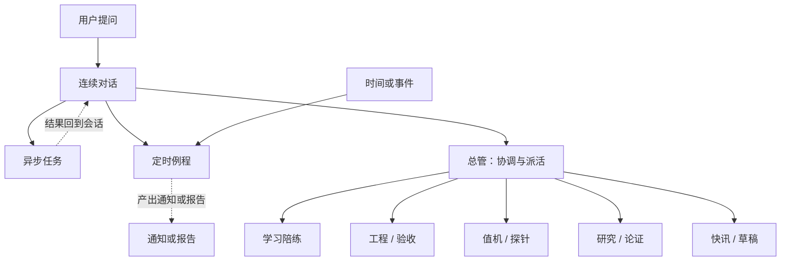

# grokbot-workflow-notes

概念笔记：连续对话、异步任务、定时例程与多角色分工。本仓库不含产品源码。

[jjh-python667](https://github.com/jjh-python667)（工匠）· 人工智能专业大一 · 设计型开发者 · 正在巩固 Python。

作品集在 [jjh-python667.github.io](https://jjh-python667.github.io/)，本笔记有[项目页](https://jjh-python667.github.io/projects/grokbot-workflow-notes.html)。个人域名 jjhbuilds.com 还在备案和部署准备中。计划接下来学习 C、C++、算法和 NumPy。

## 目录

- [简介](#简介)
- [Introduction](#introduction)
- [笔记覆盖的内容](#笔记覆盖的内容)
- [概念分层](#概念分层)
- [阅读顺序](#阅读顺序)
- [怎么使用](#怎么使用)
- [现状](#现状)
- [下一步](#下一步)
- [相关项目](#相关项目)
- [许可](#许可)

## 简介

这份说明回答同学常问的四件事：连续对话怎么接上，异步任务和例程是什么意思，多角色怎么分工，以及这里说的 harness 是不是某一个开源项目的别名。

这里没有要运行的程序。阅读顺序见 [下方的表](#阅读顺序)。文件索引在 [docs/README.md](docs/README.md)。

## Introduction

[jjh-python667](https://github.com/jjh-python667) is a first-year undergraduate student in artificial intelligence; the public portfolio is [jjh-python667.github.io](https://jjh-python667.github.io/). These notes describe continuous conversation, async work, scheduled routines, and a few generic roles in a Cursor Grok Bot setup, and why “harness” here is not the name of one open-source project.

Nothing needs to be installed: read them on GitHub, or clone the repository and open the Markdown. The reading order is the table on this page, and [docs/README.md](docs/README.md) indexes the files.

## 笔记覆盖的内容

1. **连续对话**。在同一会话上下文中多轮追问、改需求、接上次结论。平台侧负责会话与工具编排，而不是每次从零粘贴全部历史。见 [docs/async-and-memory.md](docs/async-and-memory.md)。
2. **异步任务 / 后台执行**。长耗时或可后台进行的工作，可以理解为发起后不必一直盯着同一条聊天流。结果再汇总回会话或例程通知。具体界面以平台为准。
3. **定时例程（routines）**。按时间或事件触发的重复任务，例如日报、巡检、提醒。这是调度与执行的产品能力，不是本仓库里的脚本集。
4. **多角色协作**。用通用角色名理解即可：总管协调、学习陪练、工程验收、值机探针、研究论证、快讯草稿。各角色有边界。详见 [docs/architecture.md](docs/architecture.md)。

下图只概括 [docs/](docs/README.md) 里已经写过的路径。



## 概念分层

| 层 | 公开说法 |
|----|----------|
| 本仓库 | Markdown 概念笔记。打开文件即可阅读 |
| 平台 | Cursor Grok Bot。对话、工具、连接器、例程由平台提供 |
| 协作 | 多角色技能与派活约定，只写到概念级 |
| 本地扩展 | 可以接自建 MCP、插件或仓库侧工具。路径与密钥不进本仓库 |
| Harness | 泛指编排与约束执行的外壳：会话、工具、异步、例程。这里不是给某个开源项目起的别名 |

## 阅读顺序

| 顺序 | 文件 | 用途 |
|------|------|------|
| 1 | [docs/what-is-not-included.md](docs/what-is-not-included.md) | 未公开内容清单。先读这篇 |
| 2 | [docs/architecture.md](docs/architecture.md) | 高层架构、通用角色名，以及文内的 mermaid 图 |
| 3 | [docs/async-and-memory.md](docs/async-and-memory.md) | 连续对话、异步执行与定时例程 |

## 怎么使用

在 GitHub 上按 [阅读顺序](#阅读顺序) 打开即可。若要离线阅读：

```bash
git clone https://github.com/jjh-python667/grokbot-workflow-notes.git
cd grokbot-workflow-notes
```

克隆之后直接读 Markdown。

若要在自己的 Cursor 账号里使用同类能力，走平台公开路径：

1. 使用 Cursor 与账号所在地区实际开放的 Grok Bot 能力。
2. 只连接公开文档允许的连接器。密钥放在本机或平台保险库，不提交到 Git。
3. 多角色分工写成自己可公开的职责说明。职责边界、输入输出和禁止事项由自己撰写，不粘贴他人私有 skill 全文。
4. 异步与例程在平台支持的前提下自行配置。本仓库只解释概念，不提供私有调度配置。
5. 对照架构图和未公开清单学习，把产品能力与可以放进公开仓库的说明分开。

隐私上保持脱敏：仓库中不放密钥、token、cookie、真实邮箱、手机、QQ、API Key、账单、私聊全文或本地隐私目录。对同学演示时使用虚构示例和这些公开文档。推送前再看一眼 diff。

## 现状

| 项目 | 状态 |
|------|------|
| 三篇概念文档与本页说明 | 已在仓库中，可直接阅读 |
| 自动化检查 | 没有可运行程序，仓库里也没有 CI |

## 下一步

- 继续只维护可公开的概念说明。
- 按学习进度补充概念对照示例。示例保持虚构，并先对照 [未公开清单](docs/what-is-not-included.md)。

<!-- github-learning-navigation -->

## 相关项目

- [案头 ANTOU](https://github.com/jjh-python667/antou-office-agent) · [项目页](https://jjh-python667.github.io/projects/antou-office-agent.html)：本地办公 Agent 原型，v3.2。
- [学习搭子 Personal Learning Agent](https://github.com/jjh-python667/personal-learning-agent) · [项目页](https://jjh-python667.github.io/projects/personal-learning-agent.html)：个人学习 Agent，v0.4.0。用 Python、DeepSeek API 和官方 QQ 通道做的学习原型，开发过程有 AI 辅助。
- [资讯台 Newsdesk](https://github.com/jjh-python667/newsdesk) · [项目页](https://jjh-python667.github.io/projects/newsdesk.html)：用 Cloudflare Workers 与 D1 做的资讯阅读台。
- [Python 基础学习](https://github.com/jjh-python667/python-learning)：基础练习与学习记录。
- [作品集](https://jjh-python667.github.io/)

## 许可

MIT，见 [LICENSE](LICENSE)。说明文字可以引用。请勿借本仓库名义索要或传播他人私有配置。
