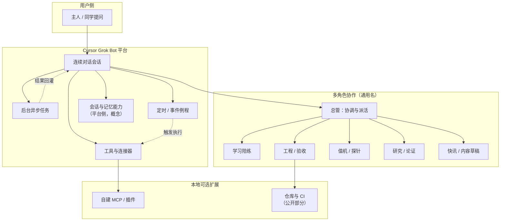
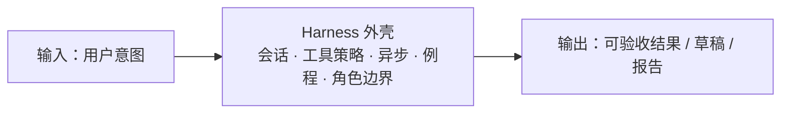
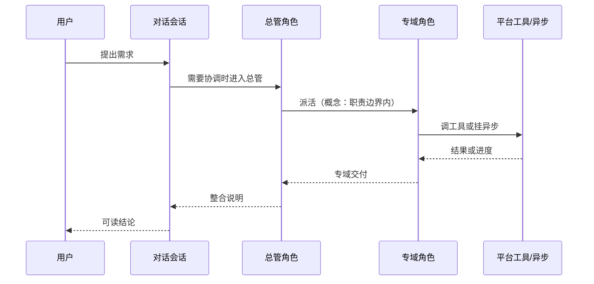

# 高层架构（概念）

本文只描述**可对外讲解**的分层与角色边界，不涉及内部服务名、桥协议细节或私有技能 id。

## 总览图

## 分层说明

1. **用户侧**  
   自然语言提需求；不要求用户理解内部调度细节。

2. **平台层（Cursor Grok Bot）**  
   - 会话：多轮上下文、工具调用编排。  
   - 连接器：在授权范围内访问日历、文档、代码托管等（具体以账号开通为准）。  
   - 异步与例程：长任务与定时/事件触发（见 [async-and-memory.md](async-and-memory.md)）。  
   - 「记忆」：公开讨论时只当作**平台提供的上下文延续能力**，不展开私有存储格式。

3. **角色层（多 agent 协作）**  
   用**通用名**，不写内部 id：

| 通用名 | 公开职责（概念） |
|--------|------------------|
| 总管 | 澄清目标、拆分、派给合适角色、整合交付；不代写他人私有技能 |
| 学习陪练 | 课程/习题/基础讲解类陪伴，边界清晰 |
| 工程 / 验收 | 需求澄清、实现交接、验收标准与回滚意识 |
| 值机 / 探针 | 对某通路做登录态/用量/可达性类检查（只讲能力类型，不讲私有桥） |
| 研究 / 论证 | 深度对比、反证、长文结构 |
| 快讯 / 草稿 | 公开信息线索与内容草稿，深入论证另交研究角色 |

4. **本地扩展**  
   可自建插件或接公开 MCP；**凭证与本机绝对路径隐私目录不进公开仓**。

## 「Harness」在本说明里的含义

- **Harness** ≈ 把模型、工具、角色约束、异步调度包在一起的**编排外壳**。  
- 本说明**不**宣称等于某一个具体开源 harness 项目名称。  
- 同学若在对比开源项目：请分别看「会话状态」「工具沙箱」「调度」「多 agent 消息总线」四块，再对照上图，避免名词绑架。

## 数据流（公开版，无密钥）

## 设计原则（可公开强调）

- **最小必要权限**：连接器与本地插件只开当前任务需要的范围。  
- **角色不越界**：工程验收不替学习陪练「代写整学期答案策略」；值机不扩散凭证。  
- **可公开 vs 私有**：架构图可公开；真实 skill 全文、桥协议、账单与私聊不可公开。  
- **推 Git 前脱敏**：本仓库即示范形态。
