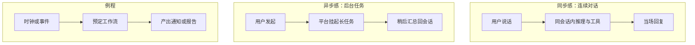

# 连续对话与异步执行（平台能力层面）

面向同学常问：「为什么可以接着聊？」「异步任务和定时例程是什么？」「这算不算某种 memory / harness？」

以下均在 **Cursor Grok Bot 平台能力** 的抽象层解释，不涉及私有实现、存储路径或协议字段。

## 1. 连续对话：如何理解

**连续对话** ≈ 在同一会话（或平台认可的延续上下文）里：

- 你改需求、追问细节时，不必每次粘贴全部历史；  
- 工具调用的中间结论可以留在会话线程里被后续轮次引用；  
- 多角色协作时，总管可以把「上一棒交付」当作下一棒输入（概念上），而不是丢失上下文。

公开讨论时建议区分三层，避免混谈：

| 层次 | 含义（笼统） | 不公开展开的 |
|------|----------------|--------------|
| 会话上下文 | 当前聊天线程里的轮次与工具结果 | 原始导出、私聊全文 |
| 平台记忆类能力 | 跨轮/跨任务的偏好或摘要（若产品提供） | 底层库表、绝对路径、密钥 |
| 用户自建笔记 | 你自己写的公开/私有文档 | 含隐私的本地目录 |

**不是**：把整个磁盘或未授权邮箱当「记忆」随便读写。  
**是**：在授权与产品边界内，让对话「接得上」。

## 2. 异步执行：如何理解

有些工作不适合「你一直盯着同一条气泡等它打完字」：

- 较长的检索、生成、批量处理；  
- 需要等待外部系统的任务；  
- 可后台跑完再汇总的工作。

在平台能力层面，可理解为：

```text
发起任务 →（可选）离开前台死等 → 后台推进 → 结果回到会话 / 通知 / 例程日志
```

同学对比开源 harness 时，常对应这些概念（名称因项目而异）：

- job / worker / queue  
- background agent  
- run 与 session 分离  

本说明**不绑定**某一开源项目的 API 名；只强调：**异步是产品编排能力，不是本 Git 仓里的一堆私有脚本。**

## 3. 定时例程（routines）

**例程** ≈ 按时间表或事件触发的重复工作流，例如：

- 每日摘要类任务（内容由你自己配置，本仓不提供私有配置）；  
- 周期性检查「某公开状态是否变化」；  
- 提醒类协作。

与「点一次跑一次」的对话任务相比：

| | 对话内任务 | 例程 |
|--|------------|------|
| 触发 | 用户一句话 | 时间 / 事件 |
| 上下文 | 当前会话为主 | 预定工作流 + 当时环境 |
| 失败处理 | 当场重试或改口令 | 需考虑漏跑、补跑（产品侧） |

## 4. 和「Memory」一词怎么说话才不容易误导

- 对同学说「有连续上下文 / 平台记忆类能力」即可。  
- 避免暗示：已开源完整记忆数据库、可下载别人的记忆快照、或本仓库含 state 文件。  
- `.gitignore` 已忽略常见 `state`、密钥文件——**正确姿势是本地私有、仓库干净**。

## 5. 一张对照图（概念）



## 6. 自学建议（无密钥版）

1. 先画清：会话 / 异步 job / 例程 三条路径。  
2. 再为每个角色写一页「输入、输出、禁止事项」（可公开）。  
3. 本地插件与连接器凭证只放保险库或环境变量，**永不进 Git**。  
4. 若阅读某开源 harness：对照「状态存在哪、工具如何鉴权、多 agent 如何传消息」三问，而不是纠结商品名是否一致。
